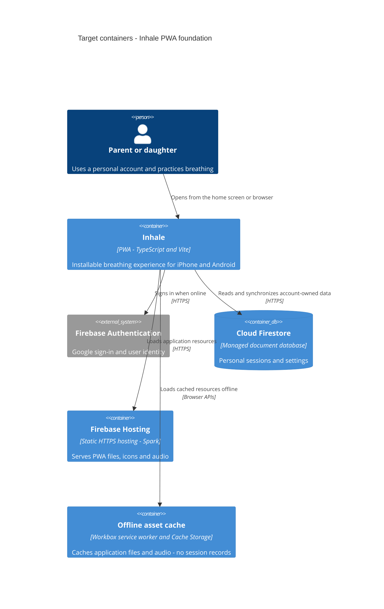

# Architecture map — Inhale

> Established greenfield foundation. This is a target baseline, not an implemented production architecture. Product choices were confirmed in the survey session; operational conventions below complete the chosen stack. Machine commands describe the planned scaffold contract and have not been executed against a production app. No scaffold execution is authorized by this planning session.

## Stack

- **Accepted:** distribute Inhale as a Progressive Web App (PWA), installed through the browser on iPhone and Android with a home-screen icon. Owner confirmed “then it's pwa.” on 2026-10-21 after comparing native installation costs and free testing limits. See [ADR 0001](adr/0001-use-pwa-distribution.md).
- **Accepted:** Firebase Authentication for Google sign-in and Cloud Firestore as the single application database for signed-in sessions/settings, using SDK-managed persistent offline caching. Guests can practice but their data is not persisted or imported. Owner removed the guest-saving requirement to avoid an additional database; see [ADR 0002](adr/0002-use-firebase-auth-and-firestore.md).
- **Accepted:** plain TypeScript with Vite, without React or another UI framework. Owner selected option 2 during the foundation session; see [ADR 0003](adr/0003-use-vanilla-typescript-and-vite.md). Scaffold selects mutually compatible stable package versions and supported Node.js LTS, pins versions and commits the npm lockfile; these are not existing installed versions.
- **Accepted:** Vitest for logic tests, Playwright for browser flows, Firebase Emulator-based tests for data access rules/integration, and ESLint for linting. Owner explicitly accepted these tools. Script definitions and their verification are in the command contract below.
- **Accepted:** feature-first modules with clean architecture dependency rules. Domain and application code remain independent of Firebase, DOM and browser APIs. Infrastructure/UI adapters depend inward; the app composition root supplies concrete adapters. See [ADR 0005](adr/0005-organize-features-with-clean-architecture.md).
- Owner explicitly approved this structure to accommodate future meditation, water reminders and other habits. Add these as separate feature modules when their scope is specified; do not scaffold empty future modules or a generic habits engine. The first release remains breathing-focused (`docs/adr/0005-organize-features-with-clean-architecture.md`).
- **Accepted:** Firebase Hosting on the no-cost Spark plan, initially using the provided domain. Owner confirmed the free plan works for the project. GitHub Actions will run checks and create PR previews; production deploys automatically after an approved PR is merged and checks pass. Owner explicitly chose automatic production releases. Preview builds must use test backend data. See [ADR 0004](adr/0004-use-firebase-hosting-and-github-actions.md). Workflows and credentials are not yet configured; no cloud resources have been created.
- **Accepted:** Workbox service-worker tooling for caching the application shell, icons and bundled guidance audio. It does not store session records or replace Firestore. Download updates while the current app runs; activate/reload only when no practice is active, including no starting or paused practice. Owner confirmed this policy. See [ADR 0006](adr/0006-cache-pwa-assets-with-workbox.md).
- Existing reference uses HTML, CSS and browser JavaScript, not a selected production toolchain. Reference-only checks are `node --check prototype-glass/app.js` and `node prototype-glass/verify.cjs` (`prototype-glass/README.md:12`).

### Planned command contract

Scaffold must create and run these scripts. These are foundation choices, not inferred successful commands. Update this map if the commands that actually work differ.

| Command | Planned implementation / purpose |
|---|---|
| `npm ci` | Reproducible dependency install from committed lockfile |
| `npm run dev` | Vite development server |
| `npm run typecheck` | `tsc --noEmit` |
| `npm run build` | `npm run typecheck` followed by `vite build` |
| `npm run preview` | Serve built assets with Vite for local smoke checks |
| `npm run test:unit` | `vitest run`; include an actual baseline smoke test |
| `npm run test:firebase` | Firebase CLI `emulators:exec` for Auth and Firestore with a dedicated test runner/config; no cloud data access |
| `npm run test:browser` | `playwright test` against built assets; Chromium and WebKit projects |
| `npm run lint` | ESLint, including restricted imports to enforce feature/layer rules |

No SQL migration tool applies. `migration_tool: ""` is intentional. Firestore rules/index configuration is version-controlled; data-shape changes use explicit versioned document fixtures and reviewed transforms when needed. Do not create an empty SQL migration just to satisfy a generic scaffold checklist.

## C4 — system as it is

Target baseline with accepted distribution, cloud services and Firestore-managed offline persistence. Planned module structure follows below; deployment configuration remains to be planned. This does not represent a working offline implementation.



## Module inventory

| Module | Path | Layers | Wired at | Responsibility |
|---|---|---|---|---|
| Approved UX reference | `prototype-glass/` | HTML shell, CSS styling, browser script | `prototype-glass/index.html:14`, `prototype-glass/index.html:24` | Reference behavior and Glass v2 appearance; preserve during planning |
| Product and planning documents | `docs/` | Brief, decisions, flows, foundation | `docs/idea-brief.md:67` | Accepted scope and outstanding decisions |

`screens/` contains reference images, not production modules. The following production paths are planned, not yet present:

| Planned module | Planned path | Internal layers | Planned wiring | Responsibility |
|---|---|---|---|---|
| Composition | `src/app/` | Bootstrap, navigation, cross-feature orchestration | `src/app/bootstrap.ts` | Construct adapters and connect feature interfaces |
| Breathing | `src/features/breathing/` | domain, application, infrastructure, UI | Composition root | Rhythm/session state machine, practice actions, audio, wake and lifecycle adapters |
| Sessions | `src/features/sessions/` | domain, application, infrastructure, UI | Composition root | Account-owned session records, history and Firestore persistence |
| Settings | `src/features/settings/` | domain, application, infrastructure, UI | Composition root | Timing/preferences validation, account settings and Firestore persistence |
| Auth | `src/features/auth/` | application, infrastructure, UI; domain only if needed | Composition root | Google sign-in, sign-out and account identity |
| Shared foundations | `src/shared/` | UI, styles, i18n, Firebase initialization | Composition root and outer adapters | Reusable Glass primitives, translations and one Firebase client initialization |
| PWA lifecycle | `src/pwa/` | Service worker and update integration | Composition root | Workbox file/audio caching and coordinated app updates |

Use this layout as the convention; create each layer only when it contains real behavior. Colocate Vitest tests with source. Put Playwright scenarios in `tests/browser/` and Emulator/rules checks in `tests/firebase/`.

```text
src/
  app/
    bootstrap.ts
    navigation.ts
    finish-practice.ts
  features/
    breathing/
      domain/          # Practice state, phase calculations and invariants
      application/     # Start/pause/resume/stop; consumer-owned clock/audio/wake ports
      infrastructure/  # Browser clock, audio, wake and lifecycle adapters
      ui/              # DOM screen, controls and rendering
      index.ts         # Explicit feature interface
    sessions/
      domain/          # Session records and invariants
      application/     # Record/list sessions; repository port
      infrastructure/  # Firestore adapter and serialization
      ui/              # History/details DOM views
      index.ts
    settings/          # Same layer convention where needed
    auth/              # Same convention; no empty domain layer
  shared/
    firebase/          # SDK initialization; imported only by outer adapters/bootstrap
    ui/
    styles/
    i18n/
  pwa/
    service-worker.ts
tests/
  browser/
  firebase/
```

## Conventions (cited — the rules a new feature must match)

- **Product behavior:** preserve continuous breathing, timing controls and whole-cycle rounding (`docs/features/mindful-breathing/product-decisions.md:3`).
- **UI / styling:** reuse the approved Glass design, light/dark geometry and English/Ukrainian experience (`docs/features/mindful-breathing/approved-design.md:7`).
- **Ownership and sync intent:** persist only signed-in account data; guest practice is transient with no import. Merge account sessions without duplicates; latest saved settings win (`docs/idea-brief.md:71`).
- **Dependency rule:** domain imports only its own pure code. Application imports its domain and declares narrow dependency interfaces (ports). UI/infrastructure import application/domain; inner layers never import concrete Firebase, DOM, Workbox or browser implementations. Bootstrap supplies adapters explicitly (`docs/adr/0005-organize-features-with-clean-architecture.md`).
- **Feature communication:** callers use a feature's `index.ts`, never another feature's internal files. Features have no direct runtime dependencies on one another initially; `src/app/` orchestrates combined flows. A neutral DTO can cross public interfaces without exposing Firebase document types (`docs/adr/0005-organize-features-with-clean-architecture.md`).
- **Completion flow:** breathing returns a practice outcome; app orchestration checks identity and asks sessions to record it only for the signed-in owner. A guest outcome remains transient. Sessions never imports the breathing engine. This is the concrete precedent for cross-feature composition (`docs/adr/0005-organize-features-with-clean-architecture.md`).
- **Ports and tests:** use ports at real I/O seams, such as Firestore repository versus in-memory test adapter, and browser clock versus controlled test clock. Do not add generic repositories or pass-through interfaces to every function (`docs/adr/0005-organize-features-with-clean-architecture.md`).
- **IDs:** create session IDs once on the client with `crypto.randomUUID()` and reuse the same ID across retries. Wall-clock time is display metadata, not a uniqueness or conflict-order guarantee. This convention replaces prototype `Date.now()` IDs (`prototype-glass/app.js:106`; `docs/adr/0002-use-firebase-auth-and-firestore.md`).
- **Errors:** application actions expose typed outcomes with stable codes, such as `unauthenticated`, `permission-denied`, `storage-unavailable`, `unavailable` and `invalid-input`; UI maps them to localized messages. Keep Firebase exception details inside adapters. Distinguish locally queued writes from confirmed remote saves; never wait for remote acknowledgement before allowing breathing UI to continue (`docs/adr/0005-organize-features-with-clean-architecture.md`; `docs/adr/0002-use-firebase-auth-and-firestore.md`).
- **Data evolution:** each persisted document has a `schemaVersion`; schema/index/rules changes and compatible readers are version-controlled. Test old/new fixtures in the emulator before deployment. Initial scaffold creates only test fixtures and safe rules/index configuration; no real user migration is needed yet (`docs/adr/0002-use-firebase-auth-and-firestore.md`).
- **Tests / CI:** use the command contract above. Enforce inner-layer independence with ESLint import restrictions; test outer Firestore adapters against real emulators, not SDK mocks alone. Cloud rules/index deployment is an explicitly tested part of release planning, not automatically supplied by a Hosting-only action (`docs/adr/0004-use-firebase-hosting-and-github-actions.md`).

## Datastores

| Store | Engine | Accessed via | Notes |
|---|---|---|---|
| Prototype sessions and preferences | Browser localStorage | `prototype-glass/app.js:4`, `prototype-glass/app.js:101` | Existing reference only; no implemented cloud sync |
| Production cloud store | Cloud Firestore | Firebase web SDK; database rules must enforce account ownership | Accepted service; schema and rules are not yet designed. See ADR 0002 |
| Signed-in offline persistence | Firestore SDK-managed persistent browser cache | Firebase web SDK | Enable persistent caching and verify offline save/restart/reconnect. This is Firestore's internal browser storage, not a second application-managed database. Guest state stays in memory; no custom IndexedDB/idb session store (`docs/idea-brief.md:71`) |

## Frontend / UI foundation

- **Component library / design system:** approved Glass v2; no third-party production kit selected (`docs/features/mindful-breathing/approved-design.md:7`).
- **Design tokens:** CSS variables for backgrounds, panels, borders, text and accents; light values at `prototype-glass/glass.css:2`, dark values at `prototype-glass/glass.css:23`. Some dimensions and colors remain hard-coded.
- **Styling approach:** vanilla CSS with shared design tokens under `src/shared/styles/` and feature-scoped class names/styles. Port the existing Glass appearance, not a new component kit. Reference uses base CSS in `prototype-glass/index.html:7` and overrides in `prototype-glass/glass.css:2`.
- **Shared primitives:** glass panels, transport buttons, phase cards, bottom navigation, numeric inputs, segmented controls, session cards and summary tiles (`prototype-glass/app.js:89`, `prototype-glass/app.js:90`, `prototype-glass/app.js:99`).
- **State / data-fetching:** feature-owned typed in-memory state with explicit render subscriptions; Firestore adapters map SDK records/events to application models. No additional state-management or server-cache library is selected. Guest state is memory-only. Reference state/storage: `prototype-glass/app.js:44`, `prototype-glass/app.js:101`.
- **Closest UI precedent:** continuously mounted breathing screen across ready/preparation/practice/pause (`prototype-glass/app.js:79`). Preserve blur fallback, reduced motion and reduced transparency treatments (`prototype-glass/glass.css:17`).

## Where things live / closest precedents

- Breathing timing and controls: `prototype-glass/app.js:104`; this is behavior to preserve, not proof of production lifecycle correctness.
- Settings and live calculations: `prototype-glass/app.js:65`, `prototype-glass/app.js:173`.
- Sessions list and summary: `prototype-glass/app.js:92`, `prototype-glass/app.js:99`. Use accepted product term **Sessions** rather than legacy **Journal** (`docs/idea-brief.md:45`).

## Constraints & known tech-debt

- Target users are in Ukraine; the daughter is 14 (owner-reported during this foundation session). Exact phone models, OS versions and parental-control settings remain unknown.
- Browser installation removes the Apple Developer membership requirement for this distribution route. Firebase Hosting on Spark and its provided domain are accepted; custom domain purchases and paid services are not selected.
- PWA installation and usable offline resources must be tested on physical iPhone and Android devices. First-ever loading/caching requires connectivity; offline use before first sign-in remains required.
- Validate home-screen launch, cached audio, Google sign-in with the actual accounts, persistence after restart, keep-awake and interruption handling. Browser storage can be evicted; cloud sync is not evidence that unsynchronized local data is safe.
- Preferred lifecycle remains keep-screen-awake and pause-on-leaving. Do not assume that screen-off timers or background synchronization run continuously (`docs/idea-brief.md:74`).
- Accounts, synchronization and offline guidance are accepted product scope but are absent from the prototype (`docs/idea-brief.md:71`).
- Browser adapters use standard browser APIs for audio, visibility and screen wake; add helper dependencies only with a demonstrated implementation need. Workbox and the Firebase SDK are the selected capability libraries. Missing wake support must be visible to device verification; do not silently choose screen-off continuation.
- Feature specification/design must resolve settings conflict ordering, identity changes during practice, queued writes at sign-out, cache lifecycle and exact audio assets. These product/runtime details do not block the structural scaffold, but block acceptance of their feature flows.
- Scaffold setup must discover actual GitHub repository/default branch, project IDs, two Spark projects for production and test backend separation, deployment credentials, Google sign-in configuration, chosen Firestore region and compatible package/runtime versions. Never assume these exist. Default service domains suffice; no purchase, Blaze upgrade or region selection is performed by survey.

### Physical-device acceptance prerequisites

Scaffold acceptance requires installing and opening the starter PWA from its HTTPS URL on the owner's actual iPhone and Android phones. Record model, OS/browser version, date and observed outcome; these facts are currently unknown. Confirm icons and standalone launch, offline cold reopen of the starter shell after caching, and repeatable install/update instructions. A desktop WebKit run is not an iPhone installation result.

Functional device acceptance later covers breathing, spoken/tonal audio, wake behavior, leaving/locking the app, Google sign-in with the real supervised account if applicable, signed-in offline writes/restart/reconnect, account changes and update deferral during active or paused practice. Scaffold must not implement all product features to prove its installation path.

## Reconciliation with the authored architecture doc

No authored production architecture document was found. `docs/Plan Phase.md:50` explicitly treats the browser prototype as a UX reference and calls for a separately agreed foundation. Its mobile-build/signing plan predates the owner's PWA choice; replace native build acceptance with browser installation and physical-device PWA checks in the forthcoming scaffold plan. The original plan is preserved.

`docs/idea-brief.md` remains the source of product intent. PWA changes distribution, not offline practice, separate accounts, cloud sync or approved UX. Earlier flows describing local-only scope or stop-to-summary are stale relative to the accepted decisions and prototype (`docs/idea-brief.md:55`, `prototype-glass/app.js:108`). This survey does not rewrite them without their owning stage.
