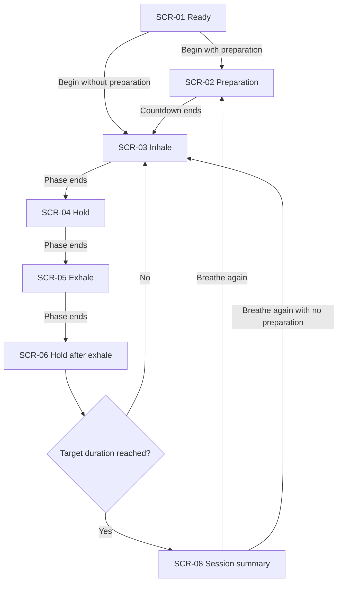
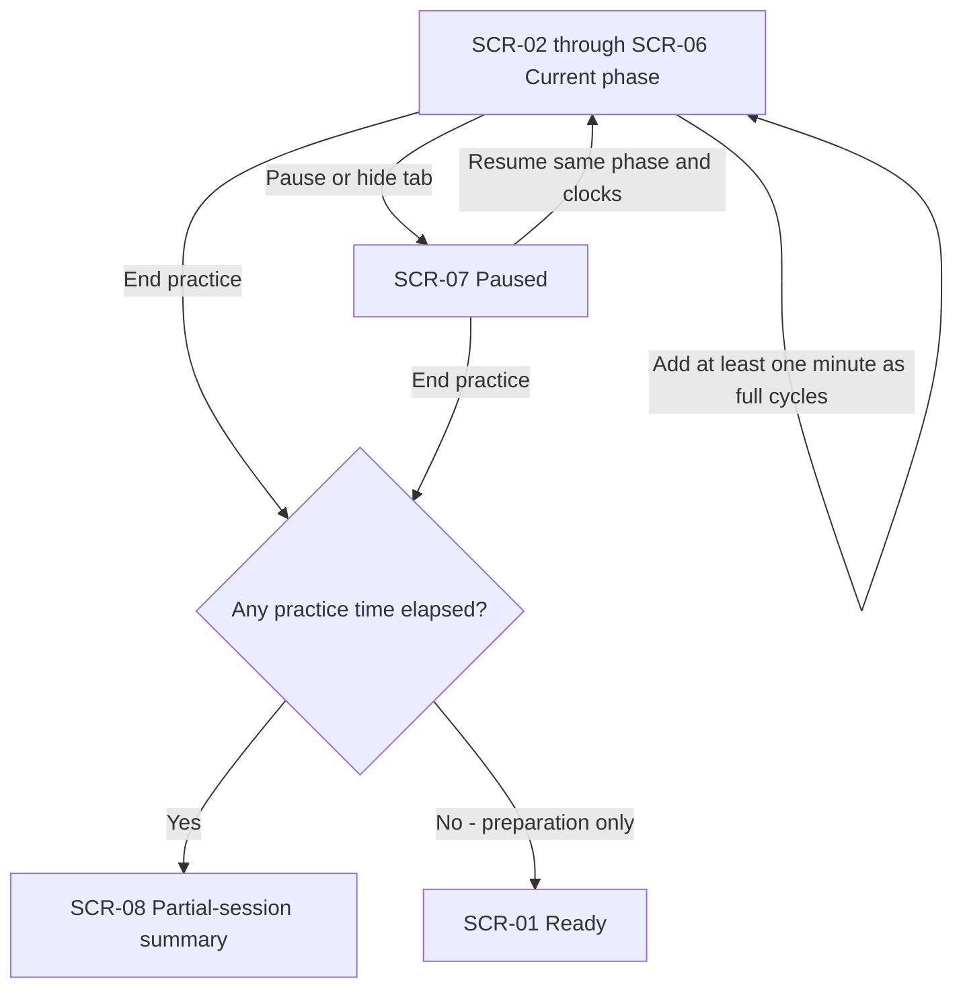
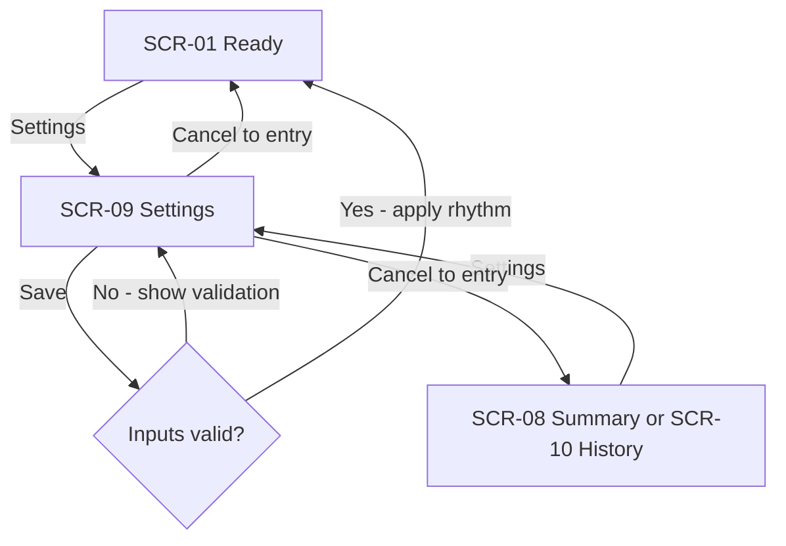
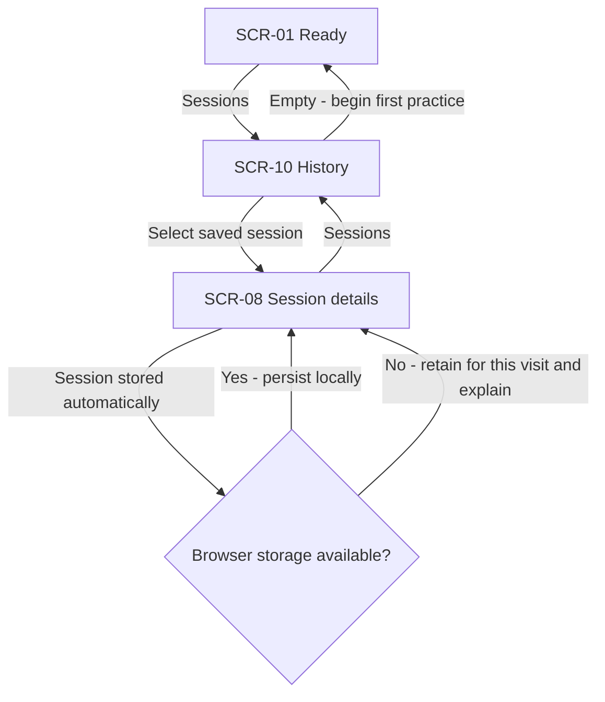

# Mindful breathing — reconstructed user flows

This is a screenshot-derived exploration, not an approved product specification. The user explicitly authorized bypassing the sdd-ux-flows spec prerequisite and requested an HTML mockup. No spec user stories or acceptance criteria exist; the provisional stories and checks below do not claim spec approval. Visual design lives in `prototype-glass/`, separately from this flow document.

## Platform and review assumptions

- Confirmed product direction: mobile-first for iPhone and Android. The current artifact remains a responsive web prototype, with an outer desktop review panel. Platform direction does not yet select a native framework. App copy supports English and Ukrainian; screenshot copy is Ukrainian. The prototype includes safe-area bottom spacing, 44–48px minimum navigation/control targets and 16px inputs to avoid iPhone input zoom.
- No `docs/design-system.md`: code-mode assumptions. Size/route are unspecified; the skill default is M / standard, for documentation depth only.
- Screenshot controls and states are evidence; transitions between static images are inferred unless otherwise stated.
- Reference 9 shows a 1:2:1:2 ratio at 3 seconds per unit, a five-second preparation and five requested minutes plus six seconds. The prototype interprets that as rounding 300 seconds up to 306 seconds (17 complete 18-second cycles), excluding preparation.
- Screenshots 3–4 contain operating-system screenshot tools and volume controls. These are not app screens.
- Pause/resume, complete-cycle duration rounding, automatic pause on hiding the tab, settings validation, a completion destination, history list and local session persistence are proposed behavior.
- No accounts, cloud sync, real sound, notifications, achievements, dynamic breathing editor or medical outcome claims are included. Other visible navigation icons lack enough evidence to reconstruct those areas.
- This is a direct prototype pass. Flow confirmations and a spec-based AC map remain open; no automatic document commit is made while these are unresolved.

## Screen inventory

| ID | Screen/state | Evidence | Entry | Exit |
|---|---|---|---|---|
| SCR-01 | Breathing screen: ready | 1 | Launch; save settings; discard preparation | Prepare; settings; history |
| SCR-02 | Breathing screen: starting | 2 | Begin practice when preparation > 0 | Inhale; pause; end to ready |
| SCR-03 | Breathing screen: inhale | 3 | Preparation ends; begin with no preparation; cycle rest ends | Hold; pause; end |
| SCR-04 | Breathing screen: hold after inhale | 4 | Inhale ends | Exhale; pause; end |
| SCR-05 | Breathing screen: exhale | 5 | Hold ends | Rest; pause; end |
| SCR-06 | Breathing screen: hold after exhale | 6–7 | Exhale ends | Inhale; completion; pause; end |
| SCR-07 | Breathing screen: paused | Inferred | Pause during preparation or practice; tab hidden | Resume same phase; end |
| SCR-08 | Session summary/details | Metrics from 8; destination inferred | Complete session; end after practicing; history item | Begin again; history; settings |
| SCR-09 | Timing settings | 9–10 | Ready, summary or history | Save to ready; cancel/back to entry |
| SCR-10 | Session history, including empty state | Inferred | Sessions navigation | Session details; ready; settings |

## Provisional story 1 — complete a guided practice

As a person taking a mindful break, I want to follow a visible breathing rhythm and know when my practice ends.

In words: begin, settle in if enabled, then follow inhale, hold, exhale and hold. Repeat full cycles until the rounded target duration. View the summary and optionally begin another practice. Preparation is excluded from practice metrics.

## Provisional story 2 — control an ongoing practice

As a person practicing, I want to pause, extend or end without losing my place.

In words: pausing freezes the current phase and remaining session time; resume continues them. Add-minute extends the target by the smallest whole number of cycles totaling at least 60 seconds. Ending a practice records elapsed practice time and fully completed cycles. Ending during preparation returns to ready and creates no session. Navigation is disabled during practice; the prototype review controls can deliberately abandon a preview and jump elsewhere.

## Provisional story 3 — adjust the rhythm

As a person preparing, I want to adjust duration and pacing before beginning.

In words: open settings from ready, summary or history. Adjust 1–30 requested minutes, 1–10 seconds per unit (only whole or half seconds permitted), and 0–30 preparation seconds. Saving valid inputs applies the rhythm and returns to ready. Invalid inputs remain editable. Cancel returns to the screen that opened settings and discards timing changes. The phase durations, cycle length, cycle count and rounded session duration update live as timing inputs change, without applying unsaved values. English/Ukrainian language selection updates app content immediately, preserves timing drafts and persists when browser storage is available.

## Provisional story 4 — review a past moment

As a person building a habit, I want to revisit sessions in a simple journal.

In words: open Sessions; if empty, begin a first practice. Otherwise choose a saved session and inspect date, duration, cycles, rhythm rate and cycle length. Sessions save locally; storage failure retains data for the current visit and displays that limitation. Settings reset on reload; sessions persist when storage works. Prototype summary jumps use an explicitly labeled 36-second example that is never saved.

## Coverage ledger

There are no spec §5 ACs. These provisional checks make screenshot reconstruction reviewable; they are not approved ACs.

| Check | Source | Flow / branch |
|---|---|---|
| R-01 Ready offers start and visual rhythm | 1 | Story 1 / A |
| R-02 Preparation precedes practice | 2 | Story 1 / B |
| R-03 Four distinct breathing phases loop | 3–7 | Story 1 / C–F |
| R-04 Pause and resume preserve clocks | Controls in 2–7; behavior inferred | Story 2 / A–B |
| R-05 Stop shows partial metrics or discards preparation | Stop in 2–7; transition inferred | Story 2 / Q |
| R-06 Add-minute extends by complete cycles | +1 in 2–7; behavior inferred | Story 2 / A self-loop |
| R-07 Timing unit determines 1:2:1:2 rhythm | 9–10 | Story 3 / B–Q |
| R-08 Validation and cancel preserve prior settings | Inferred | Story 3 / Q, cancel |
| R-09 Summary includes date, duration, cycles, rate, cycle length | 8 | Story 4 / C |
| R-10 Empty history and storage failure have a path | Inferred | Story 4 / B, Q |

No backend-only stories were supplied.

## Open review decisions

1. Confirm whether the default 3:6:3:6 rhythm should carry over to the new app; it is reproduced from screenshots rather than prescribed.
2. Confirm whether early stops should save automatically and whether the 300-to-306-second interpretation is correct.
3. English and Ukrainian are now selectable in Settings. The outer prototype review annotations remain English.
4. Confirm whether sound, other exercise types and the remaining screenshot navigation destinations are in scope later.

## Verification and handoff

The HTML prototype is at `prototype-glass/index.html`; open directly or serve the repo and visit `/prototype-glass/`. No installation or build is required. The flow uses only declared SCR IDs and every inventory row participates in at least one flow. Mermaid receives structural validation if no renderer is installed; that is weaker than a renderer parse check. Spec-based approval/coverage remains unresolved, so the skill's formal 4/4 completion and commit gate are not claimed. After reviewing the prototype, capture a spec and establish `docs/design-system.md` before proceeding through formal architecture stages.

Executed `node --check prototype-glass/app.js`, `node prototype-glass/verify.cjs` and `git diff --check`: passed. The dependency-free state checks cover preparation, four-phase ordering, pause/resume, full completion, preparation discard, partial stops, zero preparation, fractional timing, tab hiding, storage failure and settings validation. Four Mermaid blocks passed structural checks; no Mermaid renderer was installed. Browser preview attempts could not connect to localhost, so visual layout and browser interactions remain unverified.

## Browser review changes

Applied the user’s review: remove notes and the duplicate header action; remove ready-screen introduction and journal eyebrow/count; retain a simple journal rather than activity tiles (later comment supersedes earlier suggestion). Timing accepts only integer or half-second units and previews calculations immediately. Settings includes English/Ukrainian language selection, saved independently from timing changes. Added verification for rejected 1.1-second values, accepted 1.5-second values, live 2.5-second calculations, language switching with draft preservation, journal simplicity and absence of notes. JavaScript syntax, state checks and whitespace validation pass; browser visual verification remains unperformed.

## Continuous breathing screen

SCR-01 through SCR-07 are states of one mounted screen, not separate pages. The chart, heading, timer, progress bar and four duration blocks keep their positions. The bottom control row is always visible in this order: Add-minute, Play/Pause, Stop (square icon). Play begins the starting countdown, changes to pause while running, and changes back to play when paused. Its accessible label changes between Start, Pause and Resume in the selected language. Add-minute and Stop are disabled before starting. Pausing freezes the clocks and displays a faint, noninteractive pause symbol on the chart. Stop saves elapsed practice to the journal when applicable, resets the clocks, hides the chart pause symbol and stays on the ready screen with Play available. Natural completion still opens session details. The four blocks read Inhale, Hold, Exhale, Hold and highlight the active phase. Review navigation merges ready and preparation into Breathing practice. Regression checks cover persistent screen markup, pause indication and stop/reset/restart; execution of the latest checks is blocked by the host process launcher error (HRESULT 0x80070020).
